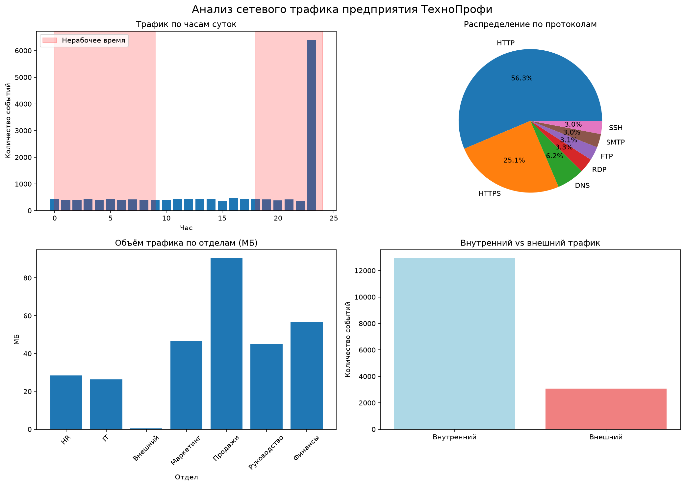

# Система мониторинга сетевого трафика («ТехноПрофи»)

Учебный проект по дисциплине «Информационная безопасность бизнес-процессов», лекция «Обеспечение сетевого трафика предприятия».

## Возможности
- Анализ и классификация трафика, выявление нарушений политик (из лекции)
- **Обнаружение DDoS** по числу пакетов в секунду на целевой IP
- **Журнал аудита** с цепочкой хешей SHA-256 (проверка целостности)
- **Оповещения** в Telegram и Slack
- **Расчёт ROI** внедрения (`docs/roi_report.md`)

## Запуск
```bash
git clone https://github.com/mimimi-maks/network-traffic-monitor.git
cd network-traffic-monitor
python -m venv .venv && source .venv/bin/activate
pip install -r requirements.txt
python main.py
```

## Структура
Каталог `src/`: `traffic_analyzer.py`, `ddos_detector.py`, `audit_log.py`, `notifier.py`, `roi_calculator.py`.

## Результаты


Расчёт окупаемости: [docs/roi_report.md](docs/roi_report.md)

## Ограничения
Используются имитационные данные и пороговые методы. В реальной системе
применяются ML-анализ, UEBA, интеграция с SIEM/SOAR.